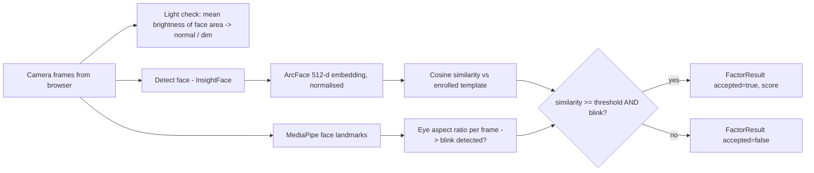

# Face verification factor: design (M2)

| | |
|---|---|
| **Factor name** | `face` (category: something you **are**) |
| **Owner** | M2 (Sevinch) |
| **Status** | Week 2 design. Comparison demo in [`experiments/`](experiments/README.md). Webcam → embedding week 4, enrollment week 5, LFW threshold week 6, blink liveness week 7, light check weeks 8–11 |
| **Related** | [`docs/interface.md`](../../../../docs/interface.md), Trust Lab [`metrics.md`](../../../../trust-lab/docs/metrics.md) |

## 1. Pipeline



**Libraries (no models trained by us):**
- **InsightFace**, model pack `buffalo_l`: RetinaFace detector + **ArcFace** recognition model
  (Deng et al., 2019). `FaceAnalysis(name="buffalo_l")`, `app.prepare(ctx_id=-1)` runs on CPU.
  `face.normed_embedding` is a 512-number vector with length 1, so **cosine similarity = dot product**.
- **MediaPipe Face Mesh**: 468 face landmarks per frame, used for the eye aspect ratio.
- **OpenCV**: decoding frames, converting colour spaces, brightness.

The browser sends frames; all processing happens on the server (the browser only captures).

## 2. Enrollment

1. The browser captures **10 frames** over about 3 s (`fps = 3`) while the user looks at the camera
   (ask them to turn the head slightly so the template covers small pose changes).
2. **Quality checks per frame** (frame dropped if it fails; enrollment fails if fewer than 5 remain):
   - exactly **one** face detected (`len(faces) == 1`), else drop (two faces = someone else in view);
   - face box at least **112 px** wide (ArcFace input size; smaller faces give poor embeddings);
   - detection score `face.det_score ≥ 0.6`;
   - not blurry: variance of the Laplacian of the face crop ≥ 50 (`cv2.Laplacian(gray, cv2.CV_64F).var()`);
     the exact value is tuned on our webcams in week 5;
   - light: enrollment should be done in **normal** light (dim → ask the user to find more light),
     because the template should be the best possible reference.
3. **Template** = mean of the good frames' embeddings, **re-normalised** to length 1. Averaging reduces
   the effect of one bad frame.
4. **Storage:** the template (512 floats) in PostgreSQL, table `face_templates (user_id, embedding, n_frames,
   created_at)`. **Frames are not stored.** Never in git (`*.npy` is git-ignored anyway).
5. Optional (decide in week 5): store a second template enrolled on the phone, because laptop and phone
   cameras differ a lot. Then verification uses the best of the two.

## 3. Verification

1. `start()` tells the browser how many frames to send (below). The browser captures **15 frames at 5 fps
   (3 s)** and asks the user to blink once.
2. For every frame: detect faces (must be one), compute the embedding, similarity with the template.
3. **Score** = median similarity over the frames with a usable face. The median ignores a few bad
   frames (motion blur during the blink).
4. **Decision:** `accepted = score ≥ threshold AND liveness_passed`.
5. **Score for `FactorResult.score`** (0–1): ArcFace similarities are in −1…1, and in practice
   different people score around 0–0.3 and the same person 0.4–0.8. We report
   `score = max(0, similarity)` (clipped to 0–1, higher = more genuine). M1 computes EER from this.
   If the liveness check fails, `accepted = false` but `score` is still the similarity (so the
   Trust Lab can see that a printed photo matched the face but failed liveness).
6. **Time budget (≤ 3 s target):** InsightFace on CPU takes roughly 100–300 ms per frame on a laptop, so
   15 frames would be 2–4 s. Plan: run the detector + embedding on **every 3rd frame** (5 frames), run
   MediaPipe (fast, ~10 ms) on all 15. Measure in week 4 and adjust.

**Threshold (week 6, with M1):** compute the similarity of LFW **genuine pairs** (same person) and
**imposter pairs** (different people), using M1's `trustlab.metrics`:
- report the **EER** and its threshold;
- choose the operating threshold at a **target FAR of 0.1%** (security first; face is a strong factor
  only if it rarely accepts someone else) and report the FRR there;
- check the threshold on our own volunteers' webcam data (laptop/phone × normal/dim), since LFW photos
  are better quality than webcams in dim light.
Starting value before LFW: `0.35` (used in the demo only).

## 4. Liveness (blink) and light check

**Blink liveness (week 7):** eye aspect ratio (EAR) from 6 landmarks per eye
(Soukupová & Čech, 2016):

```
EAR = (|p2 − p6| + |p3 − p5|) / (2 · |p1 − p4|)
```

p1/p4 are the eye corners, p2/p3 the upper lid, p5/p6 the lower lid. Open eye ≈ 0.25–0.35, closed
eye < 0.2. MediaPipe Face Mesh indices: right eye `[33, 160, 158, 133, 153, 144]`, left eye
`[362, 385, 387, 263, 373, 380]`. EAR = mean of both eyes, computed in **pixel** coordinates (landmarks
are normalised 0–1 separately for x and y).

A **blink** = EAR goes from open (> 0.25) to below **0.2** for 1–3 consecutive frames and back to open.
At 5 fps a blink (100–400 ms) lasts 1–2 frames, so 5 fps is the minimum; if blinks are missed in tests we
raise it to 10 fps for the liveness part. Thresholds are adjusted per user with the open-eye EAR from
enrollment (e.g. blink = below 70% of the user's open EAR).

`liveness_passed = true` if at least one blink is seen in the 15 frames.

Known limit: a **video** of the victim that contains a blink passes this check (`screen_replay`). This is
expected and will be measured, and it is why face's attack-resistance score may be lower than its
accuracy.

**Light check (weeks 8–11):** mean brightness (the V channel of HSV, 0–255) of the face box in the
first usable frame. **`dim` if below 70, else `normal`** (first guess, calibrated with lux measurements in
the dim/normal test sessions, see M1's attack protocol). The value goes into `FactorResult.context.light`
and fills `LoginContext.light`.

## 5. Plug-in behaviour (from week 3, against `base.py`)

| Method | Behaviour |
|---|---|
| `is_enrolled(user_id)` | a template exists for the user (database read, `async`) |
| `is_available(ctx)` | `ctx.has_camera` (proposed LoginContext field) |
| `start(user_id, ctx)` | returns the capture settings below |
| `verify(user_id, payload, ctx)` | pipeline above → `FactorResult` |
| `enroll_start` / `enroll_finish` | capture settings for enrollment / quality checks + store template |
| mock | accepts if `payload["mock_accept"]` is true, `context` filled with `light: "normal", liveness_passed: true` |

**Proposed payloads (for interface v0.2):**

```json
// start() returns
{ "frames_needed": 15, "fps": 5, "blink_required": true, "timeout_s": 10 }
// verify() payload from the browser
{ "frames": ["data:image/jpeg;base64,...", "..."], "fps": 5 }
// FactorResult
{ "factor": "face", "accepted": true, "score": 0.62, "duration_ms": 2600,
  "context": { "light": "dim", "liveness_passed": true }, "error": null }
```

- Frames are **JPEG, 640×480, quality 0.8** (`canvas.toDataURL("image/jpeg", 0.8)`), about 30–60 KB
  each, so 15 frames ≈ 0.5–1 MB per verify request. FastAPI's default body limit is fine; the core
  should allow at least 2 MB on this endpoint.
- Frames are processed in memory and **never written to disk or the database**.

**Error codes:**

| Situation | `accepted` | `error` |
|---|---|---|
| No template | false | `not_enrolled` |
| No camera / camera permission denied (browser reports it) | false | `unavailable` |
| User did not finish in `timeout_s` | false | `timeout` |
| Frames missing / not decodable | false | `bad_payload` |
| **No face (or more than one) in every frame** | false | **proposed new code `no_face`** (see below) |
| Face found, similarity below threshold, or no blink | false | `null` (the factor ran, the user failed) |

**Proposal: `no_face` error code.** "No face found" is different from a malformed request
(`bad_payload`): it happens to genuine users in dim light or when the camera points away. The Trust Lab
should count it against **availability / usability**, not accuracy. Alternative if the team prefers a
short list: use `unavailable` with `context.reason = "no_face"`.

## 6. Privacy

- Face embeddings are **biometric personal data**. They can identify a person and cannot be changed if
  leaked.
- Store only the template (not images), only for consenting volunteers, with pseudonymised user IDs,
  locally; delete all templates at the end of the project. Mentioned in the consent form (M1).
- LFW is a public research dataset; it is downloaded to `datasets/lfw/` (git-ignored) and not
  redistributed.
- Attack material (printed photos, videos of volunteers) follows M1's attack protocol rules.

## 7. Interface review: open question 7

**Q7: face sets `light` after the first frame, but selection already happened. Should the engine
re-check?** Proposal: **no re-selection during the face attempt**, but:

1. The face factor reports `light` in `FactorResult.context` (already planned), so the attempt is logged
   with the correct condition (`phone_dim` etc.) and the Trust Lab uses the right trust value.
2. **Before selection**, the engine can use a cheap hint: the browser measures the brightness of one
   camera frame on the login page (no face detection needed, a few lines of canvas code) and sends
   `light_hint` with the login start. The engine then uses `phone_dim` vs `phone_normal` trust from the
   start. (Requires camera permission before login; if not given, `light_hint = null` → engine assumes
   `normal`.)
3. If face **fails** and `light = "dim"`, the core's fallback (open question 4) replaces face with the
   next-best factor instead of a retry, because a retry in the same light is likely to fail again.

Confirmed face `context` keys: `light` (`"normal"` / `"dim"`), `liveness_passed` (bool).

## 8. Proposals for interface v0.2

1. Face payloads as in §5 (`start()`, `verify()` payload).
2. New error code `no_face` (or `unavailable` + `context.reason`).
3. Optional `light_hint` (`"normal" | "dim" | null`) in the login-start `client` object (Q7).
4. Verify endpoint body limit ≥ 2 MB (frames).
5. `enroll_finish` returns `{"done": bool, "reason"?: "too_few_good_frames" | "too_dark" | ...}` (same
   pattern as M3's proposal).
