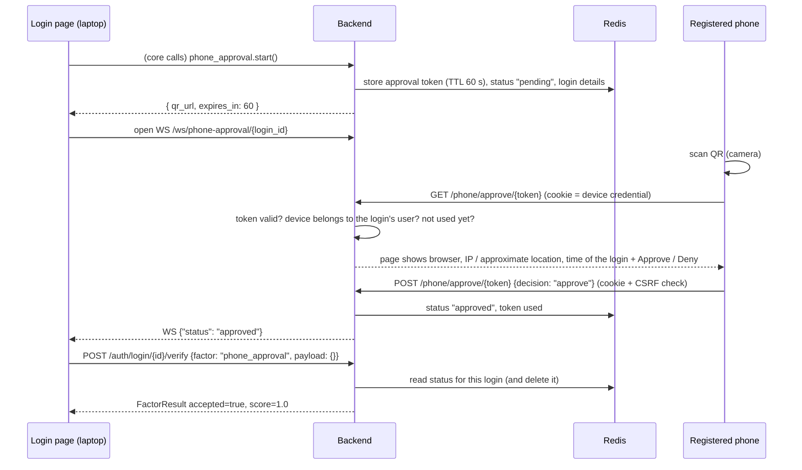

# Phone approval factor: design (M2)

| | |
|---|---|
| **Factor name** | `phone_approval` (category: something you **have**: the registered phone) |
| **Owner** | M2 (Sevinch) |
| **Status** | Week 2 early design. Mock week 3, real implementation + WebSocket weeks 8–11 |
| **Related** | [`docs/interface.md`](../../../../docs/interface.md) §6 (WebSocket) |

## 1. Idea

The login page shows a **QR code**. The user scans it with their **registered phone**, the phone shows
what is being logged into, and the user taps **Approve** or **Deny**. The login page learns the answer
live over a WebSocket.

Because the QR must be scanned from the login screen, the phone has to be **physically near** the
screen. This makes "approval spamming" much harder than with push notifications.

## 2. Enrolling (registering) a phone

The phone needs a secret that proves "I am the phone registered to user X". No native app is in scope,
so the phone uses its **browser**:

1. Logged in on the laptop, the user opens *Register phone*. The server creates a one-time
   **registration token** (random, 60 s, Redis) and shows it as a QR code.
2. The user scans it with the phone camera → the phone opens `https://<host>/phone/register/<token>`.
3. The server checks the token (exists, not expired, delete it: single use), then creates a
   **device credential**: a random 256-bit secret (`secrets.token_urlsafe(32)`), stores its **SHA-256
   hash** with the user ID and a device label in PostgreSQL, and sets the secret as a cookie on the phone:
   `HttpOnly; Secure; SameSite=Strict; Max-Age=180 days`, path `/phone/`.
4. The phone shows "This phone is now registered for <username>".

Table `phone_devices (device_id, user_id, secret_hash, label, created_at, last_used_at, revoked)`.

Why a hash: if the database leaks, the cookie secret cannot be recovered (same idea as passwords; the
secret is long and random, so a fast hash is enough). Why a cookie: no app needed; the phone browser
sends it automatically.

**Alternative (stronger, decide week 8):** register a **WebAuthn credential on the phone** instead of a
cookie, then approving needs fingerprint/face on the phone too. Reuses M3's passkey code. Downside: more
work, and phone approval then overlaps with the passkey factor.

## 3. Login flow



**Important:** `verify()` does **not** trust the browser. The payload is empty; the factor reads the
status that the **phone** wrote in Redis. A login page cannot claim "approved".

## 4. Token rules

| Rule | Value |
|---|---|
| Format | `secrets.token_urlsafe(32)` (random, 256 bits, URL-safe) |
| QR content | `https://<host>/phone/approve/<token>` |
| Lifetime | **60 s** (Redis TTL). A new QR is created if the user asks ("Show new code") |
| Single use | Status moves `pending → approved / denied` once; a second scan sees "already used" |
| Bound to | `login_id` and `user_id` (stored with the token, never taken from the phone request) |
| Redis key | `phone_approval:<token>` → `{login_id, user_id, status, browser, ip, created_at}`; plus `phone_approval:login:<login_id>` → token, so `verify()` can find it |
| Wrong phone | A device credential of another user → page says "This phone is not registered for this account"; nothing is changed |

## 5. What the phone page shows

- "Someone is trying to log in to **TrustAuth** as **<username>**"
- Browser and device of the login (`Chrome 131 on Windows`, from LoginContext)
- IP address and, if available, approximate location (city level; optional, needs a local GeoIP database)
- Time of the request
- Two big buttons: **Approve** and **Deny ("This wasn't me")**
- A countdown until the request expires

Showing these details is the main defence against `qr_relay`: the user can notice that the browser or
location is not theirs.

## 6. WebSocket messages

`WS /ws/phone-approval/{login_id}` (server → login page only):

```json
{ "status": "waiting" }      // sent once on connect
{ "status": "scanned" }      // the phone opened the page (UI: "Check your phone")
{ "status": "approved" }
{ "status": "denied" }
{ "status": "expired" }      // 60 s passed with no decision
```

After `approved` / `denied` / `expired` the server closes the socket. The login page then calls
`verify()` (for `approved`) or shows retry / fallback (core decides, open question 4). The WebSocket only
**informs** the page; the decision is always read from Redis in `verify()`.

Only the browser that started the login may open the socket: the core checks the login session cookie
when the socket opens.

## 7. Plug-in behaviour (from week 3, against `base.py`)

| Method | Behaviour |
|---|---|
| `is_enrolled(user_id)` | user has ≥ 1 non-revoked phone in `phone_devices` |
| `is_available(ctx)` | `ctx.device_type == "laptop"` (on a phone the user cannot scan its own screen; see note) |
| `start(user_id, ctx)` | creates token, returns `{ "qr_url": "...", "expires_in": 60 }` |
| `verify(user_id, payload, ctx)` | reads the status from Redis → `FactorResult` |
| `enroll_start` / `enroll_finish` | registration QR / registration complete |
| mock | accepts if `payload["mock_accept"]` is true; `start()` returns a fake QR URL |

Note: if the user logs in **on the registered phone itself**, scanning is impossible. v1: not available
on phones. Later option: a "Approve on this device" button when the login browser has the device cookie.

**Payloads:**

```json
// start() returns
{ "qr_url": "https://<host>/phone/approve/3q2-...", "expires_in": 60 }
// verify() payload from the browser
{}
// FactorResult
{ "factor": "phone_approval", "accepted": true, "score": 1.0, "duration_ms": 9800,
  "context": { "scanned": true }, "error": null }
```

**Error mapping:**

| Situation | `accepted` | `error` |
|---|---|---|
| Approved | true | `null` |
| Phone tapped **Deny** | false | `cancelled` |
| Expired with no decision (incl. never scanned) | false | `timeout` |
| No registered phone | false | `not_enrolled` |
| Login on a phone (v1) | false | `unavailable` |
| `verify()` called while still pending | false | `bad_payload` (the page must wait for the WS message) |

Open point for the team: should **Deny** be `cancelled` (user chose) or `accepted=false, error=null`?
A deny by the real user during an attack is a *successful defence*, so for the Trust Lab it matters. We
propose `cancelled` and a context key `decision: "denied"`, so both readings are possible.

## 8. Attacks and defences

| `attack_type` | Attack | Defences |
|---|---|---|
| `qr_relay` | Fake login page starts a real login as the attacker and shows our real QR to the victim; the victim scans and approves | Phone shows browser / IP / location / time of the **attacker's** login; 60 s expiry limits how long a relayed QR is useful; WebSocket and verify are bound to the attacker's login session, so only the attacker benefits, which is exactly what is measured |
| `mfa_fatigue` | Attacker with the password starts many logins hoping the victim approves one | A request only reaches the phone if the QR is **scanned**, so requests cannot be pushed to the victim; additionally rate limit: max **3** phone-approval starts per user per 10 min, then the engine should pick another factor |
| stolen device cookie | Malware / someone copies the cookie from the phone | HttpOnly + Secure cookie; devices can be revoked; out of scope beyond that |
| token guessing | Guess a valid token | 256-bit random tokens, 60 s life, rate limiting on `/phone/approve` |

## 9. Proposals for interface v0.2

1. Payloads in §7 (`start()` → `{qr_url, expires_in}`, `verify()` payload `{}`).
2. WebSocket statuses: add `waiting` and `scanned` to `approved | denied | expired`.
3. Context keys for `phone_approval`: `scanned` (bool), `decision` (`"approved" | "denied" | null`).
4. New endpoints (owned by M2, routed by the core): `GET/POST /phone/approve/{token}`,
   `GET /phone/register/{token}`.
5. Rate limit: max 3 `phone_approval.start()` per user per 10 minutes; after that `is_available()`
   returns false for this user.
